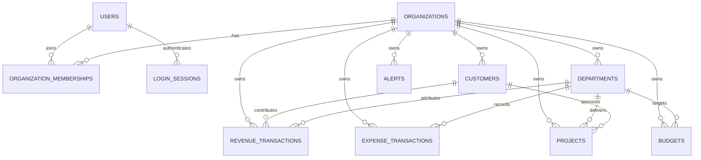

# Database schema

SQLAlchemy models are in `backend/app/models.py`; Alembic revisions under `backend/alembic/versions` are the schema deployment mechanism. Apply migrations before starting the API. Startup does not call `Base.metadata.create_all()`.

| Table | Important fields and constraints |
|---|---|
| `users` | Unique normalized email, Argon2 password hash, active and email-verified flags, creation time |
| `organizations` | Name, ISO currency, demo flag, creation time |
| `organization_memberships` | User/organization foreign keys, unique pair, constrained role (`owner`, `admin`, `analyst`, `viewer`) |
| `login_sessions` | User foreign key, unique HMAC session-token digest, CSRF-token digest, active organization, expiry/revocation timestamps |
| `email_action_tokens` | User foreign key, unique HMAC token digest, purpose, expiry/consumption timestamps |
| `rate_limit_buckets` | HMAC rate-limit key, fixed-window start, atomic hit count |
| `audit_events` | Optional actor/organization, action and entity metadata, request ID, timestamp; indexed for organization and actor history |
| `departments` | Organization foreign key, name; unique organization/name |
| `customers` | Organization foreign key, name, segment, status, account owner; unique organization/name |
| `revenue_transactions` | Organization/customer/department foreign keys, external ID, date, signed `Numeric(14,2)` amount, currency, description, revenue type; unique organization/external ID; organization/date index |
| `expense_transactions` | Organization/department foreign keys, date, signed `Numeric(14,2)` amount, category, description; organization/date index |
| `budgets` | Organization/department foreign keys, monthly period, revenue target, expense budget; unique organization/period/department |
| `projects` | Organization/customer/department foreign keys, manager, dates/status, budget/cost, planned/actual progress |
| `alerts` | Organization foreign key, severity, explanation/action, detection time, acknowledgment flag |

Amounts are stored as decimals, not binary floating point. Revenue may be negative to represent refunds, and expenses may be negative to represent credits or reversals. Business API operations enforce tenant predicates in application queries; foreign keys alone do not provide tenant authorization. Audit events intentionally omit business payloads and are not tamper-proof against privileged database access. Refresh tokens, invitations, persisted opportunities, milestones, and import history are not modeled.

## Migration and timezone notes

`0001_initial` establishes the original schema; `0002_account_security` adds email verification, rate limiting, and audit history. Test upgrades against a disposable database before deploying changes to shared data. Production configuration requires MySQL PyMySQL and migrations use the same verified TLS engine settings as the API; automated migration smoke tests currently use SQLite. Timestamps are naïve UTC-style values; organization time-zone configuration is not implemented. Financial transaction dates are calendar dates.
