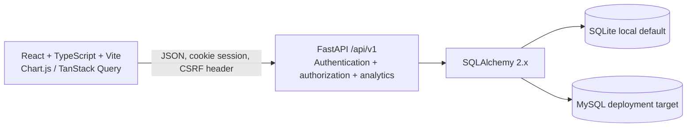

# System architecture

## Runtime shape

FastAPI owns identity, tenant context, permission checks, validation, calculations, imports, and report generation. SQLAlchemy owns persistence and Alembic owns schema evolution. TanStack Query owns browser server-state caching; organization selection is sent as a hint and validated against server-side membership before use.

## Identity and tenant boundary

Registration creates a user, an organization, and an owner membership in one transaction. Login creates a hashed server-side session and sets an HttpOnly session cookie plus a readable CSRF cookie. The raw CSRF token is returned at authentication time; after reload the frontend reads the CSRF cookie and sends the value in `X-CSRF-Token`. The backend compares its digest to the authenticated session record.

Every tenant API derives the user and membership from the session cookie. `X-Organization-ID` selects only among organizations the authenticated user belongs to. Record lookups and writes include the active organization predicate, and relationship IDs are checked against that organization. Roles are `owner`, `admin`, `analyst`, and `viewer`.

## Startup and data

- Apply reviewed migrations with Alembic before starting the API.
- The API does not create tables at startup.
- Demo mode seeds the deterministic synthetic organization after the migration has been applied.
- Revenue, expense, and budget values use `Numeric(14, 2)`; transaction dates are calendar dates.
- CSV/PDF executive reports use the same tenant-scoped calculations as the dashboard.

## Deployment boundary

Docker Compose is a local development stack. Production requires TLS, managed secrets, a reviewed MySQL configuration, migrations as a one-off deployment step, operational backups, monitoring, and account lifecycle controls. See [Security](./SECURITY.md) and [Known limitations](./KNOWN_LIMITATIONS.md).

## Design decisions

- Modular monolith rather than microservices.
- No paid APIs, LLM requirement, or third-party analytics.
- Demo pipeline stages are clearly synthetic and are not persisted opportunities.
- Forecasting, persistent opportunity lifecycle, and advanced accounting measures are excluded rather than approximated as authoritative.
